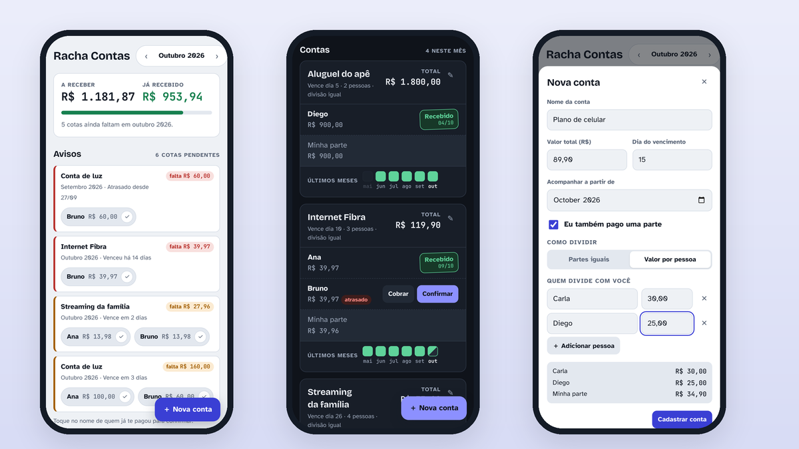
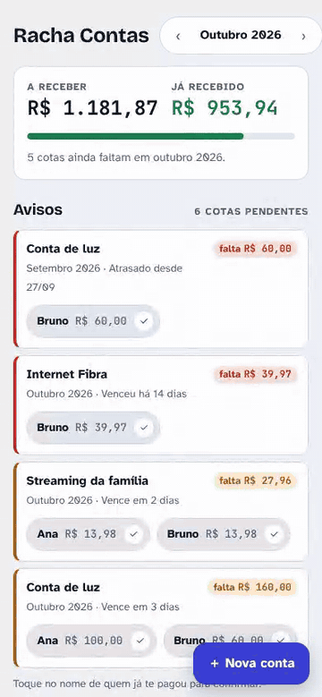
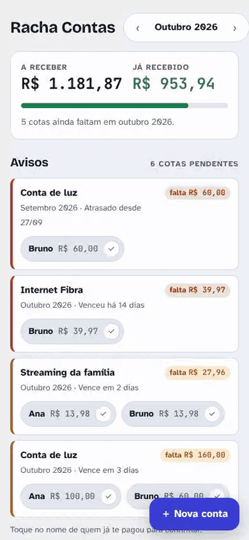
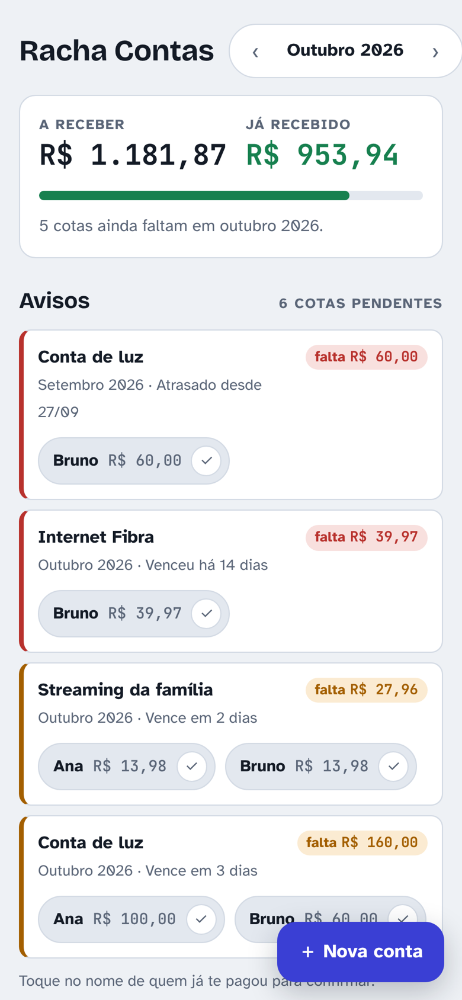
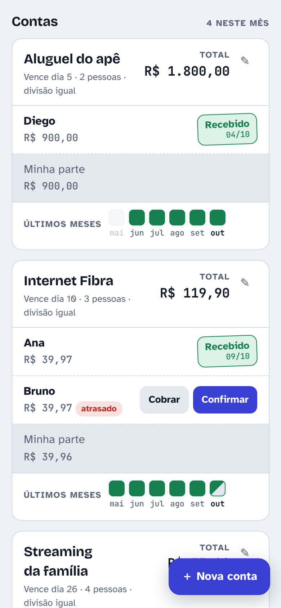
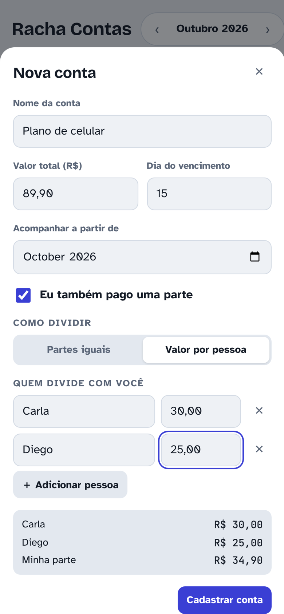
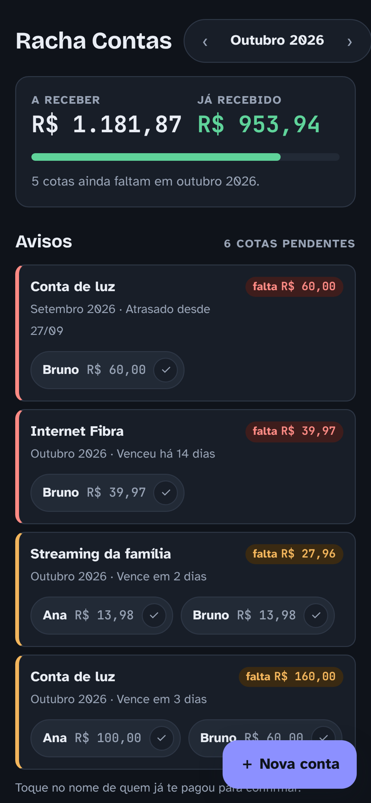
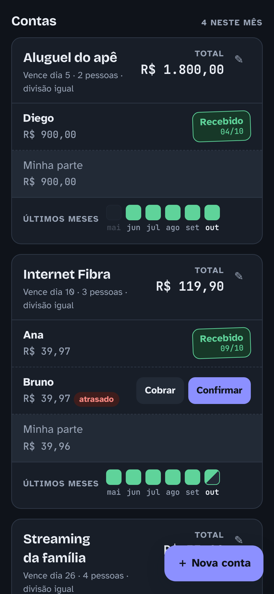
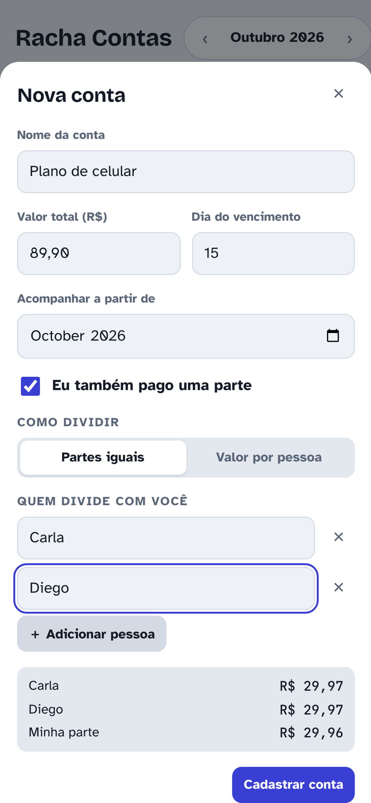

<div align="center">

# Racha Contas

**Você paga a conta e divide com outras pessoas. O Racha Contas lembra quem já te pagou.**

[**Abrir o app →**](https://maicksilva.github.io/racha-contas/)



<sub>Todas as imagens usam dados fictícios.</sub>

</div>

---

## A ideia

Muitas contas da casa ficam no nome de uma pessoa só: a internet, o streaming, a luz, o aluguel. Essa pessoa paga tudo e depois precisa receber a parte de cada um, todo mês.

Com o tempo vêm as dúvidas: *"a mãe já me passou a parte da internet desse mês?"*, *"o Bruno ficou devendo a luz de setembro?"*. Um bloco de notas ou uma planilha até ajudam, mas não avisam nada nem mostram o histórico de forma simples.

O Racha Contas resolve só isso, sem complicação:

1. **Cadastre a conta** com o valor total, o dia do vencimento e as pessoas que dividem com você.
2. **O app calcula a parte de cada um**, em partes iguais ou com um valor para cada pessoa.
3. **Todo mês, confirme** quem já te pagou com um toque.
4. **Os avisos mostram** o que está atrasado e o que vence nos próximos dias.

> Exemplo: uma internet de R$ 50,00 dividida entre você, sua mãe e seu irmão. Cada um paga R$ 16,67. No começo do mês, os dois aparecem como pendentes. Quando cada um te pagar, você toca no nome e ele sai da lista.

## Como funciona

### Confirmar um recebimento

Os avisos ficam agrupados por conta e por mês. Quem ainda não pagou aparece em um botão: tocar no nome confirma o pagamento, e a pessoa sai da lista. Lá embaixo, na ficha da conta, o pagamento aparece com um carimbo e a data.

<p align="center"></p>

### Cadastrar uma conta

Informe o nome, o valor e o vencimento, e adicione as pessoas. A divisão aparece na hora, antes de salvar.

<p align="center"></p>

## Telas

<table>
  <tr>
    <td align="center" width="33%"><br><b>Resumo e avisos</b><br><sub>Quanto falta receber no mês e o que está atrasado ou vencendo.</sub></td>
    <td align="center" width="33%"><br><b>Fichas das contas</b><br><sub>A parte de cada pessoa, os botões de cobrar e confirmar, e os últimos 6 meses.</sub></td>
    <td align="center" width="33%"><br><b>Valor por pessoa</b><br><sub>Quando a divisão não é igual, defina quanto cada um paga. O resto fica com você.</sub></td>
  </tr>
  <tr>
    <td align="center"><br><b>Tema escuro</b><br><sub>Segue o tema do celular automaticamente.</sub></td>
    <td align="center"><br><b>Histórico</b><br><sub>Verde: todos pagaram. Meio verde: só alguns. Vermelho: ninguém pagou e já venceu.</sub></td>
    <td align="center"><br><b>Partes iguais</b><br><sub>Os centavos que sobram na divisão são distribuídos sem perder nada.</sub></td>
  </tr>
</table>

## Recursos

| | |
|---|---|
| **Divisão automática** | Em partes iguais ou com um valor para cada pessoa. Você pode participar ou não da divisão. |
| **Mês a mês** | Navegue entre os meses para ver e confirmar os pagamentos de cada um. |
| **Repete sozinha** | Cadastre uma vez e a conta aparece todo mês. Para parcelamentos, escolha *Por alguns meses* e diga quantos. |
| **Valor variável** | Para luz, água e gás: o app usa o valor do mês anterior como estimativa, e você informa o valor real quando a conta chega. |
| **Valor só deste mês** | A conta veio diferente uma vez? Ajuste só aquele mês, e os outros continuam com o valor normal. |
| **Mudanças sem bagunçar o passado** | Ao editar valor ou pessoas, escolha a partir de qual mês vale a mudança. O histórico fica como estava. |
| **Juntar contas repetidas** | Se a mesma conta foi cadastrada mais de uma vez, o app avisa e junta tudo em uma conta só, mantendo os pagamentos e o valor de cada período. Dá para desfazer. |
| **Duplicar** | Crie uma conta parecida a partir de outra, já com as mesmas pessoas. |
| **Avisos** | Mostra cotas atrasadas, inclusive de meses anteriores, e as que vencem em até 3 dias. |
| **Cobrar** | Copia uma mensagem pronta, como *"Oi, Ana! Sua parte de Internet Fibra em outubro 2026 é R$ 39,97 (vence dia 10)."*, para colar no WhatsApp. |
| **Notificações** | Depois de ativadas, mostra uma notificação por dia com as pendências quando você abre o app. |
| **Funciona offline** | Instalável como app (PWA). Depois de aberto uma vez, funciona sem internet. |
| **Privado** | Os dados ficam só no seu aparelho. Nada é enviado para servidor nenhum. |
| **Backup** | Exporte e importe um arquivo `.json` para trocar de celular ou guardar uma cópia. |

## Instalar no celular

**Android (Chrome):** abra [maicksilva.github.io/racha-contas](https://maicksilva.github.io/racha-contas/), toque em ⋮ e depois em **Instalar app**.

**iPhone (Safari):** abra o link, toque em **Compartilhar** e depois em **Adicionar à Tela de Início**.

> Como os dados ficam salvos só no aparelho, use **Exportar backup** de vez em quando. Se você limpar os dados do navegador ou trocar de celular, é com esse arquivo que você recupera o histórico.

## Por dentro

Um app propositalmente simples, sem framework e sem etapa de build:

```
index.html             o app inteiro: HTML, CSS e JavaScript
sw.js                  service worker: cache para funcionar offline e clique nas notificações
manifest.webmanifest   nome, cores e ícones para instalar como app
icon*.png, icon.svg    ícone (um círculo dividido em três partes)
docs/img/              imagens desta página
```

- **Dados:** `localStorage`, na chave `racha-contas-v1`, no formato `{ contas, pags }`. As contas guardam nome, total em centavos, dia de vencimento, mês de início, modo de divisão e pessoas. Os pagamentos ficam por conta e por mês, com a data de cada confirmação.
- **Dinheiro em centavos:** todos os valores são inteiros. Na divisão igual, os centavos que sobram vão para as primeiras pessoas, então a soma sempre fecha com o total.
- **Publicação:** GitHub Pages, servindo a branch `main` a partir da raiz.

Para rodar localmente, sirva a pasta com qualquer servidor estático (o service worker não funciona abrindo o arquivo direto):

```bash
python3 -m http.server 8080
# abra http://localhost:8080
```
